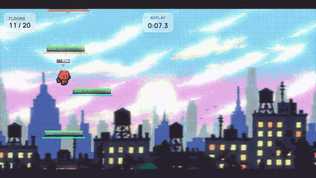

# Floor Fifty

*Don't look down.*

Floor Fifty is a four-player race up a city skyline, played in the browser. Every
racer bounces on their own. You steer, land on every floor, and get to the top
before everyone else. It runs on phones, tablets and computers, with touch,
keyboard or a controller, in six languages.



Made by [SNEKPRTY](https://snekprty.com). Players find it on Ruken, and every
race runs on one game server on Fly.io.

## How to play

1. Press **Play** and type a name.
2. **Find a race** to join anyone, **Create room** to get a six-character code for
   your friends, or type a friend's code and press **Join room**. Up to four
   players race in a room. If nobody turns up, you can fill the room with CPU
   racers.
3. Pick a character, everyone presses **Ready**, and the countdown starts.

You bounce by yourself every time you land. Your job is to steer and to land on
**every** floor on the way up. A floor you skip is hard to get back to, because
each landing throws you upward again.

| What | Keyboard | Controller | Phone or tablet |
| --- | --- | --- | --- |
| Steer | `A` / `D` or the arrow keys | Left stick or d-pad | Drag sideways, or the on-screen arrows |
| Fall fast | `S` or Down | Down, A or the right trigger | Flick down, or the fall button |
| Start the climb again | `R` | Select | |

### Modes

- **Survival**: the course never ends and the screen keeps rising. Fall below it
  and you are out. Last racer standing wins; if the clock runs out first, the
  highest floor wins.
- **20 floors**: a straight race to the top, one lap or three.
- **50 floors**: the long climb, one lap.

Each race picks a stage and a song. Characters unlock as you play, against
people or CPUs.

## Run it on your own computer

You need [Node.js](https://nodejs.org) 24 or newer and
[pnpm](https://pnpm.io) 10.

```bash
pnpm install --frozen-lockfile
pnpm assets:sync   # copies the art into the client
pnpm dev           # game at http://localhost:5173, server on port 3000
```

Open http://localhost:5173 in two browser tabs to race yourself. To play on a
phone, open `http://<your computer's local address>:5173` on the same Wi-Fi.

In development the client talks to the server at `http://127.0.0.1:3000`. A
production build talks to the address in `VITE_SERVER_URL`, set when it is
built.

### Checks

| Command | What it does |
| --- | --- |
| `pnpm test` | Unit and integration tests (Vitest) |
| `pnpm typecheck` | Strict TypeScript across every package and the tests |
| `pnpm lint` | oxlint |
| `pnpm build` | Builds the client and the server |
| `pnpm assets:check` | Checks every image and sound against the art rules |
| `pnpm content:check` | Checks the game content in `content/` |
| `pnpm test:e2e` | Browser tests (Playwright). These need a GPU |
| `pnpm netlab` | Four bots race a real server over a bad network and report how far each screen drifted from the truth |

## How it is built

```text
apps/client        The game in the browser: PixiJS draws the race, Svelte draws the menus.
apps/server        The game server: Colyseus rooms, matchmaking, health checks.
packages/shared    The race itself: Planck physics, rules, course generation and the network messages.
packages/content   Turns the TOML in content/ into the one JSON file the game reads.
packages/asset-contract
                   The art rules: the palette, the asset list and the checker.
content/           Stages, songs, characters, modes and tuning, written in TOML.
tests/             One folder per package, plus the browser tests in tests/e2e.
tools/, deploy/    Build, release, CI and hosting scripts.
```

**The server decides everything.** It runs the race at 60 ticks a second and
owns movement, collisions, laps, standings and the winner. A player's browser
only sends which way they are steering, and draws what the server sends back
20 times a second.

**Your own racer still feels instant.** The browser runs the same simulation
from `packages/shared` for your racer only, replays your inputs on top of each
server update, and smooths out any difference. Both sides apply each input on
the same tick, so the two rarely disagree. The other racers are drawn slightly
in the past, between two server updates.

**The simulation is deterministic.** `packages/shared` has no renderer, no
network, no clock and no randomness of its own. The same seed and the same
inputs always give the same race, which the tests check byte for byte.

**Content is data.** Gameplay numbers live in `content/tuning.toml`, each one
checked against a safe range declared in code. See the
[content authoring guide](docs/content-authoring.md).

**Colour is a contract.** One palette file,
`packages/asset-contract/palettes/resurrect64.hex` (Resurrect 64), generates the
colours for the game, the menus and the shaders, and `pnpm assets:check` fails
on any pixel outside it.

## Hosting

- **Game server:** Fly.io, Chicago (`ord`), as the app `floorfifty-api` at
  `https://floorfifty-api.fly.dev`. One machine holds every room, so it is never
  scaled to two. The setup is in `fly.toml` and `Dockerfile`.
- **Game client:** a static build served by Ruken. `tools/ruken-pack` packs it,
  and `vendor/ruken/` holds the Ruken SDK.
- **Health:** `GET /health` and `GET /ready` on the server.

## More docs

- [Content authoring guide](docs/content-authoring.md)
- [Copy style](docs/copy-style.md)
- [Product quality standard](docs/product-quality-standard.md)
- [Art direction](docs/art/resurrect-arcade-brief.md)
- [Changelog](CHANGELOG.md)

## The studio

Floor Fifty is made by **SNEKPRTY**: [snekprty.com](https://snekprty.com).

## License

- **Code:** open source under the [Apache License 2.0](LICENSE). Use it, change
  it and build your own game with it.
- **Content:** all rights reserved. The art, music, sound, story, characters
  and the Floor Fifty and SNEKPRTY names and logos are not open source. See
  [CONTENT-LICENSE.md](CONTENT-LICENSE.md).
- **Name:** "Floor Fifty" and "SNEKPRTY" are trademarks. You may not release
  this game, or something that looks like it, as yours. See
  [TRADEMARKS.md](TRADEMARKS.md).
- **Fonts** keep their own SIL Open Font Licenses (`apps/client/public/fonts/`,
  `tools/social-edit/fonts/`).
